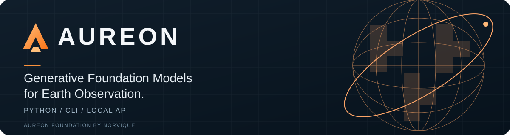
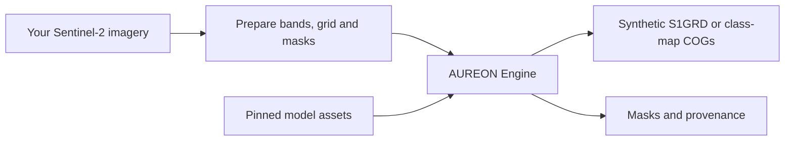

<p align="center">
  
</p>

<p align="center">
  <strong>Generative Foundation Models for Earth Observation.</strong><br>
  Specialized inference. Python, CLI, and a local API.
</p>

<p align="center">
  <a href="https://github.com/LeChiffreVol2/aureon/actions/workflows/cpu.yml"></a>
  <a href="https://github.com/LeChiffreVol2/aureon/releases/tag/v0.1.0"></a>
  <a href="packaging/START-HERE.md"></a>
  <a href="LICENSE"></a>
</p>

<p align="center">
  <a href="https://aureon-foundation.vercel.app">Website</a> ·
  <a href="docs/README.md">Documentation</a> ·
  <a href="packaging/START-HERE.md">Quickstart</a> ·
  <a href="docs/MODEL-SUPPORT.md">Models</a> ·
  <a href="https://github.com/LeChiffreVol2/aureon/releases/tag/v0.1.0">Download</a> ·
  <a href="CONTRIBUTING.md">Contribute</a>
</p>

---

The locked main v0.1.0 package (`e09e710c…`) integrates features directly with the Best runtime
derived from `0fa5ef2b…`. Its original run, owner thread, FP32 sampling, graph/reuse
and cleanup are retained. Scenes, SDK/CLI, local HTTP and private Cloud consume
that installed package; no model subprocess adapter or second wheel is required.

Adding features changes the archive hash. The delivery receipt identifies the
integrated wheel; `0fa5ef2b…` remains the immutable numerical/performance origin,
not a second installation choice. Historical failed builds remain evidence.
GitHub Release v0.1.0 now provides this exact Best wheel. Original assets and
historical comparison numbers are preserved. PyPI and hosted inference remain closed.
See the [selected installation guide](packaging/CANDIDATE-QUICKSTART.md).

AUREON is an open-source inference engine built for **Generative Foundation Models
for Earth Observation**, with support for the broader Earth foundation model family.
Start with **TerraMind**: turn a prepared Sentinel-2 L2A crop into synthetic S1GRD
VV/VH imagery, delivered as a georeferenced Cloud Optimized GeoTIFF (COG) with
provenance. **KAO-TerraMind** adds dense-prediction workflows through the same Engine.

Use Python, CLI or an authenticated local API. The published v0.1.0 library runs
on your own machine; the landing page describes the wider platform direction.

Built on TerraTorch and PyTorch, AUREON brings input validation, resident
inference and geospatial result delivery into one workflow.

The local candidate also adds [bounded stage execution and remote replica
contracts](packaging/SCALABLE-RUNTIME.md): typed job handles, resource credits,
tenant fairness, durable leases and verified artifact delivery. Native hardware
capability and numerical qualification are separate. These interfaces do not
claim measured multi-GPU/multi-host scaling or change the published downloads.

## Whole scenes and repeated jobs

The [integrated workflow](packaging/BEST-WORKFLOWS.md) connects the unchanged
numerical core to whole-scene delivery, resident sessions and bounded repeated
jobs. **224x224 is a native tile size, not a scene-size limit.** Budgets, masks,
coordinate seeds, cancellation, committed COG/provenance and recovery are explicit.
Historical aliases remain compatible; no second package is needed.

Acceptance receipts bind exact wheel bytes and tested routes. Historical
performance figures retain their original experiment scope. Exact numerical
parity does not establish seamless physical quality, long-load stability or
physical multi-GPU speed.

## Why AUREON?

| Built for | What you get |
| --- | --- |
| **Geospatial inputs and outputs** | Explicit band order, radiometry, grids and masks; georeferenced results you can inspect in GIS tools. |
| **Repeated model execution** | Resident sessions, exact eligible encoder reuse and guarded CUDA Graph execution for supported profiles. |
| **Traceable results** | Model and preprocessing identities, FP32 reference checks, provenance and verified artifact delivery. |
| **A workflow you can own** | Python, CLI and authenticated local HTTP, with separate locked dependency profiles and explicit model execution. |

## Supported workflows

The local candidate adds [prepared-scene generation, DataLoader integration and
read-only runtime diagnostics](packaging/PRODUCT-WORKFLOWS.md). Consult that guide
for limits and artifact qualification; the current Best download includes these interfaces; original alpha receipts
retain their earlier artifact scope.

| Model | Task | Input → output | Start here |
| --- | --- | --- | --- |
| **TerraMind 1.0 base** | Cross-modal generation | All-valid 224 × 224 S2L2A → synthetic S1GRD VV/VH | [First generation](packaging/START-HERE.md#first-terramind-result) |
| **KAO-TerraMind B** | Segmentation | Twelve-band Sentinel-2 L2A → class-map and validity-mask COGs | [First scene](packaging/START-HERE.md#first-kao-terramind-b-result) |

KAO-TerraMind A/C also have implemented full-reference routes with earlier-artifact
evidence. See the [support matrix](docs/MODEL-SUPPORT.md) for exact profiles,
hardware and qualification. Generated S1GRD is synthetic imagery, not an observed SAR measurement.

## Install

**Linux x86_64 or WSL2 · Python 3.12 · NVIDIA GPU for model execution**

Install the current Best wheel using the [single distribution guide](packaging/CANDIDATE-QUICKSTART.md),
then follow [input/asset preparation and generation](packaging/BEST-WORKFLOWS.md).
The model/tokenizer and user imagery remain explicit assets and are not bundled.
[Download Best v0.1.0](https://github.com/LeChiffreVol2/aureon/releases/tag/v0.1.0).
The wheel SHA-256 is `e09e710c9e9ace17b7bf2214d8c9eff2c4ed605a7d45e8c4e649b672f6f88a64`. Original alpha assets remain under historical
names on the same release; verify hashes rather than version alone.

```sh
python -m pip install "https://github.com/LeChiffreVol2/aureon/releases/download/v0.1.0/aureon_inference-0.1.0-py3-none-any.whl#sha256=e09e710c9e9ace17b7bf2214d8c9eff2c4ed605a7d45e8c4e649b672f6f88a64"
```

Use a fresh Linux/WSL Python 3.12 environment. For the tested pinned stack, use
the matching source archive locks and [release instructions](docs/releases/v0.1.0.md).
An existing installation also named 0.1.0 may still contain the original wheel.

After installation, inspect your environment without loading a model:

```sh
aureon-engine models
aureon-engine assets --model terramind-v1-base
aureon-engine check --environment generation
```

## A first look at the API

After [creating your TerraMind config](packaging/START-HERE.md#first-terramind-result),
run the same first-generation workflow from Python. Choose **either** this example
or the CLI job in the guide; both execute a model job.

```python
from pathlib import Path
from aureon.api import GenerationRequest, run_model

work = Path.home() / "aureon-work"
request = GenerationRequest(
    config=str(Path.home() / "aureon-config/generation.json"),
    output=str(work / "generation-python-first"),  # Must not exist yet.
    job_id="first",
    attempt_id="one",
    reuse="auto",
    denoiser="graph",
)
result = run_model(request, execute_model=True)

print(result["job"]["cog"]["file"]["path"])
print(result["job"]["provenance"]["path"])
print(result["cleanup"]["passed"])
```

`execute_model=True` explicitly starts inference. For a **CPU-only installation
walkthrough without imagery or weights**, use the optional
[preparation demo](docs/CPU-WALKTHROUGH.md). It checks the input pipeline with
artificial pixels; it does not generate a model prediction.

**Go further:** [Generation and resident sessions](packaging/PUBLIC-API.md) ·
[CLI quickstart](packaging/START-HERE.md) · [Local HTTP API](packaging/ASYNC-SERVICE.md)

## How it fits together



Choose Python, CLI or local HTTP for the same execution layer.
The [architecture guide](docs/ARCHITECTURE.md) explains the interfaces and result lifecycle.

## Release status

The current local **v0.1.0** distribution is the integrated best-core Engine
described in the [installation guide](packaging/CANDIDATE-QUICKSTART.md).
Its delivery receipt identifies one wheel/source pair, installed checks and the
exact scope of model acceptance. There is no current alternative feature build.

The original [published alpha](https://github.com/LeChiffreVol2/aureon/releases/tag/v0.1.0)
remains unchanged. The original [performance evidence](docs/MODEL-SUPPORT.md#historical-performance-reference)
also remains bound to its measured artifact, configuration and workload.
Neither historical release files nor historical measurements are overwritten.
No hosted API, production SLA or physical multi-GPU qualification is announced.

## Contributing

Bug reports, clearer examples, documentation fixes and focused Engine improvements
are welcome. Start with the [contributor guide](CONTRIBUTING.md) for the repository
map and CPU checks, or open a [bug report or feature request](https://github.com/LeChiffreVol2/aureon/issues/new/choose).
For installation problems, see [troubleshooting](packaging/SUPPORT.md).

## License and acknowledgments

**AUREON Foundation by Norvique** is a project of **Norvique Company**.
AUREON-owned contributions are licensed under [Apache-2.0](LICENSE).
We acknowledge the work of KAO-TerraMind, TerraMind, TerraTorch and PyTorch.
See [NOTICE](NOTICE), [third-party attribution](packaging/review/THIRD-PARTY-NOTICES.md)
and [licensing scope](docs/RIGHTS.md) for details. Model weights and datasets
retain their respective terms.

Contact: [norviccompanylimited@gmail.com](mailto:norviccompanylimited@gmail.com).
Report vulnerabilities privately through [SECURITY.md](SECURITY.md).
