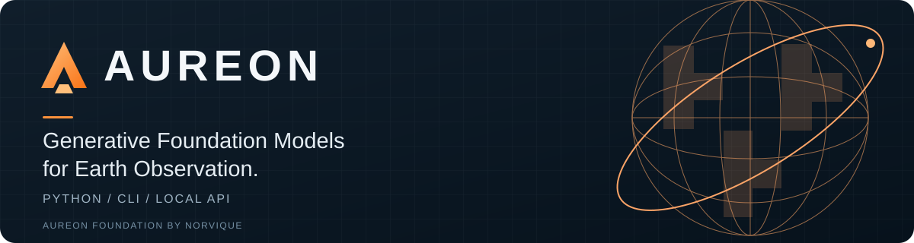
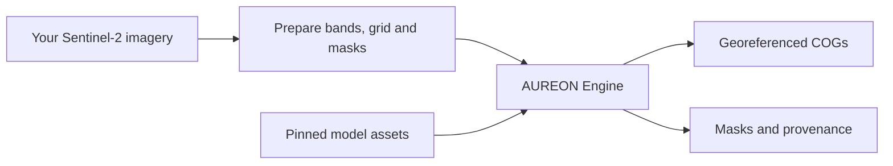

<p align="center">
  
</p>

<p align="center">
  <strong>From satellite inputs to georeferenced results.</strong><br>
  One Engine. Python, CLI, and a local API.
</p>

<p align="center">
  <a href="https://github.com/LeChiffreVol2/aureon/actions/workflows/cpu.yml"></a>
  <a href="https://github.com/LeChiffreVol2/aureon/releases/tag/v0.1.0"></a>
  <a href="packaging/START-HERE.md"></a>
  <a href="LICENSE"></a>
</p>

<p align="center">
  <a href="https://aureon-foundation.vercel.app">Website</a> ·
  <a href="docs/README.md">Documentation</a> ·
  <a href="packaging/START-HERE.md">Quickstart</a> ·
  <a href="docs/MODEL-SUPPORT.md">Models</a> ·
  <a href="https://github.com/LeChiffreVol2/aureon/releases/tag/v0.1.0">Download</a> ·
  <a href="CONTRIBUTING.md">Contribute</a>
</p>

---

AUREON is an open-source inference library for **Earth foundation models**.
Prepare your Sentinel-2 imagery, run a supported model, and receive
Cloud Optimized GeoTIFFs (COGs) with their validity masks and provenance.
Use the same Engine from a Python script, the command line, or an authenticated local service.

## Why AUREON?

| Built for | What you get |
| --- | --- |
| **Geospatial inputs and outputs** | Explicit band order, radiometry, grids and masks; georeferenced results you can inspect in GIS tools. |
| **Repeated model execution** | Resident sessions, exact eligible encoder reuse and guarded CUDA Graph execution for supported profiles. |
| **Traceable results** | Model and preprocessing identities, FP32 reference checks, provenance and verified artifact delivery. |
| **A workflow you can own** | Python, CLI and authenticated local HTTP, with separate locked dependency profiles and explicit model execution. |

## Supported workflows

| Model | Task | Input → output | Start here |
| --- | --- | --- | --- |
| **KAO-TerraMind B** | Segmentation | Twelve-band Sentinel-2 L2A → class-map and validity-mask COGs | [First scene](packaging/START-HERE.md#first-kao-terramind-b-result) |
| **TerraMind 1.0 base** | Cross-modal generation | All-valid 224 × 224 S2L2A → synthetic S1GRD VV/VH | [First generation](packaging/START-HERE.md#first-terramind-result) |

KAO-TerraMind A/C also have implemented full-reference routes with earlier-artifact
evidence. See the [support matrix](docs/MODEL-SUPPORT.md) for exact profiles,
hardware and qualification. Generated S1GRD is synthetic imagery, not an observed SAR measurement.

## Install

**Linux x86_64 or WSL2 · Python 3.12 · separate scene and generation environments**

1. Download the [v0.1.0 installation kit](https://github.com/LeChiffreVol2/aureon/releases/download/v0.1.0/aureon-0.1.0-public-alpha.zip).
2. Verify and extract it using the commands below.
3. Follow the [first-result guide](packaging/START-HERE.md) to install your dependency profile, supply model assets and prepare your input.

<details>
<summary><strong>Download and verify with the command line</strong></summary>

```sh
mkdir aureon-download && cd aureon-download
curl -fL https://github.com/LeChiffreVol2/aureon/releases/download/v0.1.0/aureon-0.1.0-public-alpha.zip \
  -o aureon-0.1.0-public-alpha.zip
printf '%s  %s\n' '3e844b14ba7a4a8138a3386ab2dd928e426ffcbf018f3183acf91a854297db07' \
  'aureon-0.1.0-public-alpha.zip' | sha256sum --check
unzip aureon-0.1.0-public-alpha.zip
cd aureon-0.1.0-public-alpha
sha256sum --check SHA256SUMS
```

The kit contains the wheel, matching source archive, examples, dependency locks
and verifier. Use the release kit and its pins; weights, imagery and GPU drivers
are supplied separately. [All release checksums →](docs/releases/v0.1.0.md)

</details>

After installation, inspect your environment without loading a model:

```sh
aureon-engine models
aureon-engine assets --model kao-terramind-b
aureon-engine check --environment scene
# For the separate TerraMind environment, use --environment generation.
```

## A first look at the API

With your [input prepared](packaging/INPUTS.md) and [KAO-TerraMind B bundle](packaging/START-HERE.md#supply-assets) ready:

```python
from aureon.api import SceneRequest, run_model

request = SceneRequest(
    prepared_input="/absolute/work/prepared-scene/manifest.json",
    bundle="/absolute/assets/kao-terramind-b",
    output="/absolute/work/first-result",  # Choose a fresh output directory.
    model_id="kao-terramind-b",
    profile_id="fp32-full-reference-v1",
    environment="scene",
)
result = run_model(request, execute_model=True)

print(result.class_map)
print(result.valid_mask)
print(result.provenance)
```

Replace the paths with your own inputs and assets. `execute_model=True` explicitly
starts inference; installation, import and metadata inspection do not execute a model.

**Go further:** [Generation and resident sessions](packaging/PUBLIC-API.md) ·
[CLI quickstart](packaging/START-HERE.md) · [Local HTTP API](packaging/ASYNC-SERVICE.md)

## How it fits together



Choose Python, CLI or local HTTP for the same execution layer.
The [architecture guide](docs/ARCHITECTURE.md) explains the interfaces and result lifecycle.

## Release status

**v0.1.0 is a public alpha.** The official wheel passed local KAO-TerraMind B512 and
TerraMind224 HTTP functional acceptance on RTX 3070 8 GiB / WSL: retained FP32
reference parity, verified outputs, replay without additional inference or usage,
and clean worker shutdown. [Scope and limitations →](docs/MODEL-SUPPORT.md)

This release supports the documented local workflows. Hosted availability,
production SLAs and broader hardware or scientific validation are outside this
qualification. Exact parity establishes execution fidelity, not accuracy on new scenes.

## Contributing

Bug reports, clearer examples, documentation fixes and focused Engine improvements
are welcome. Start with the [contributor guide](CONTRIBUTING.md) for the repository
map and CPU checks, or open a [bug report or feature request](https://github.com/LeChiffreVol2/aureon/issues/new/choose).
For installation problems, see [troubleshooting](packaging/SUPPORT.md).

## License and acknowledgments

**AUREON Foundation by Norvique** is a project of **Norvique Company**.
AUREON-owned contributions are licensed under [Apache-2.0](LICENSE).
The project builds on the work of KAO-TerraMind, TerraMind, TerraTorch and vLLM;
preserve the [NOTICE](NOTICE) and [third-party attribution](packaging/review/THIRD-PARTY-NOTICES.md).
Model weights and data retain their own terms.

The [scoped rights statement](docs/RIGHTS.md) records the approved treatment of
upstream constants/class names and the preserved upstream README discrepancy.
It supersedes only the pending owner-disposition wording in the frozen archives.

Contact: [norviccompanylimited@gmail.com](mailto:norviccompanylimited@gmail.com).
Report vulnerabilities privately through [SECURITY.md](SECURITY.md).
