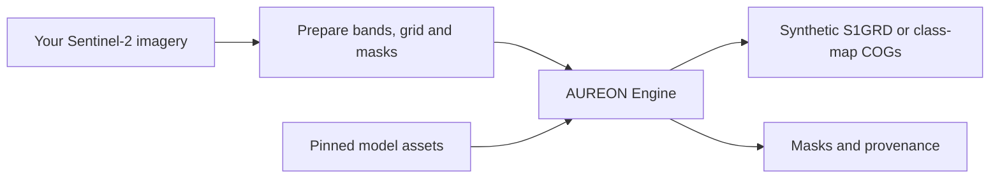

<p align="center">
  
</p>

<p align="center">
  <strong>Generative Foundation Models for Earth Observation.</strong><br>
  Specialized inference. Python, CLI, and a local API.
</p>

<p align="center">
  <a href="https://github.com/LeChiffreVol2/aureon/actions/workflows/cpu.yml"></a>
  <a href="https://github.com/LeChiffreVol2/aureon/releases/tag/v0.1.0"></a>
  <a href="packaging/START-HERE.md"></a>
  <a href="LICENSE"></a>
</p>

<p align="center">
  <a href="https://aureon-foundation.vercel.app">Website</a> ·
  <a href="docs/README.md">Documentation</a> ·
  <a href="packaging/START-HERE.md">Quickstart</a> ·
  <a href="docs/MODEL-SUPPORT.md">Models</a> ·
  <a href="https://github.com/LeChiffreVol2/aureon/releases/tag/v0.1.0">Download</a> ·
  <a href="CONTRIBUTING.md">Contribute</a>
</p>

---

AUREON is an open-source inference engine built for **Generative Foundation Models
for Earth Observation**, with support for the broader Earth foundation model family.
Start with **TerraMind**: turn a prepared Sentinel-2 L2A crop into synthetic S1GRD
VV/VH imagery, delivered as a georeferenced Cloud Optimized GeoTIFF (COG) with
provenance. **KAO-TerraMind** adds dense-prediction workflows through the same Engine.

Use Python, CLI or an authenticated local API. The published v0.1.0 library runs
on your own machine; the landing page describes the wider platform direction.

## Why AUREON?

| Built for | What you get |
| --- | --- |
| **Geospatial inputs and outputs** | Explicit band order, radiometry, grids and masks; georeferenced results you can inspect in GIS tools. |
| **Repeated model execution** | Resident sessions, exact eligible encoder reuse and guarded CUDA Graph execution for supported profiles. |
| **Traceable results** | Model and preprocessing identities, FP32 reference checks, provenance and verified artifact delivery. |
| **A workflow you can own** | Python, CLI and authenticated local HTTP, with separate locked dependency profiles and explicit model execution. |

## Supported workflows

| Model | Task | Input → output | Start here |
| --- | --- | --- | --- |
| **TerraMind 1.0 base** | Cross-modal generation | All-valid 224 × 224 S2L2A → synthetic S1GRD VV/VH | [First generation](packaging/START-HERE.md#first-terramind-result) |
| **KAO-TerraMind B** | Segmentation | Twelve-band Sentinel-2 L2A → class-map and validity-mask COGs | [First scene](packaging/START-HERE.md#first-kao-terramind-b-result) |

KAO-TerraMind A/C also have implemented full-reference routes with earlier-artifact
evidence. See the [support matrix](docs/MODEL-SUPPORT.md) for exact profiles,
hardware and qualification. Generated S1GRD is synthetic imagery, not an observed SAR measurement.

## Install

**Linux x86_64 or WSL2 · Python 3.12 · NVIDIA GPU for model execution**

The quickstart defaults to TerraMind generation. You need your own supported
Sentinel-2 GeoTIFF input and two pinned model files (about 2.67 GB combined);
dependencies and outputs need additional disk space. No image or model is bundled.
See [prerequisites](packaging/START-HERE.md#before-you-start).

1. Download the [v0.1.0 installation kit](https://github.com/LeChiffreVol2/aureon/releases/download/v0.1.0/aureon-0.1.0-public-alpha.zip).
2. Verify and extract it using the commands below.
3. Follow the [first-result guide](packaging/START-HERE.md) to install your dependency profile, supply model assets and prepare your input.

<details>
<summary><strong>Download and verify with the command line</strong></summary>

```sh
mkdir aureon-download && cd aureon-download
curl -fL https://github.com/LeChiffreVol2/aureon/releases/download/v0.1.0/aureon-0.1.0-public-alpha.zip \
  -o aureon-0.1.0-public-alpha.zip
printf '%s  %s\n' '3e844b14ba7a4a8138a3386ab2dd928e426ffcbf018f3183acf91a854297db07' \
  'aureon-0.1.0-public-alpha.zip' | sha256sum --check
python3.12 -m zipfile -e aureon-0.1.0-public-alpha.zip .
cd aureon-0.1.0-public-alpha
sha256sum --check SHA256SUMS
```

The kit contains the wheel, matching source archive, examples, dependency locks
and verifier. Use the release kit and its pins; weights, imagery and GPU drivers
are supplied separately. [All release checksums →](docs/releases/v0.1.0.md)

</details>

After installation, inspect your environment without loading a model:

```sh
aureon-engine models
aureon-engine assets --model terramind-v1-base
aureon-engine check --environment generation
```

## A first look at the API

After [creating your TerraMind config](packaging/START-HERE.md#first-terramind-result),
run the same first-generation workflow from Python. Choose **either** this example
or the CLI job in the guide; both execute a model job.

```python
from pathlib import Path
from aureon.api import GenerationRequest, run_model

work = Path.home() / "aureon-work"
request = GenerationRequest(
    config=str(Path.home() / "aureon-config/generation.json"),
    output=str(work / "generation-python-first"),  # Must not exist yet.
    job_id="first",
    attempt_id="one",
    reuse="auto",
    denoiser="graph",
)
result = run_model(request, execute_model=True)

print(result["job"]["cog"]["file"]["path"])
print(result["job"]["provenance"]["path"])
print(result["cleanup"]["passed"])
```

`execute_model=True` explicitly starts inference. For a **CPU-only installation
walkthrough without imagery or weights**, use the optional
[preparation demo](docs/CPU-WALKTHROUGH.md). It checks the input pipeline with
artificial pixels; it does not generate a model prediction.

**Go further:** [Generation and resident sessions](packaging/PUBLIC-API.md) ·
[CLI quickstart](packaging/START-HERE.md) · [Local HTTP API](packaging/ASYNC-SERVICE.md)

## How it fits together



Choose Python, CLI or local HTTP for the same execution layer.
The [architecture guide](docs/ARCHITECTURE.md) explains the interfaces and result lifecycle.

## Release status

**v0.1.0 is a public alpha.** The official wheel passed local KAO-TerraMind B512 and
TerraMind224 HTTP functional acceptance on RTX 3070 8 GiB / WSL: retained FP32
reference parity, verified outputs, replay without additional inference or usage,
and clean worker shutdown. [Scope and limitations →](docs/MODEL-SUPPORT.md)

This release supports the documented local workflows. Hosted availability,
production SLAs and broader hardware or scientific validation are outside this
qualification. Exact parity establishes execution fidelity, not accuracy on new scenes.

## Contributing

Bug reports, clearer examples, documentation fixes and focused Engine improvements
are welcome. Start with the [contributor guide](CONTRIBUTING.md) for the repository
map and CPU checks, or open a [bug report or feature request](https://github.com/LeChiffreVol2/aureon/issues/new/choose).
For installation problems, see [troubleshooting](packaging/SUPPORT.md).

## License and acknowledgments

**AUREON Foundation by Norvique** is a project of **Norvique Company**.
AUREON-owned contributions are licensed under [Apache-2.0](LICENSE).

We acknowledge the work of KAO-TerraMind, TerraMind, TerraTorch and PyTorch.
See [NOTICE](NOTICE), [third-party attribution](packaging/review/THIRD-PARTY-NOTICES.md)
and [licensing scope](docs/RIGHTS.md) for details. Model weights and datasets
retain their respective terms.

Contact: [norviccompanylimited@gmail.com](mailto:norviccompanylimited@gmail.com).
Report vulnerabilities privately through [SECURITY.md](SECURITY.md).
