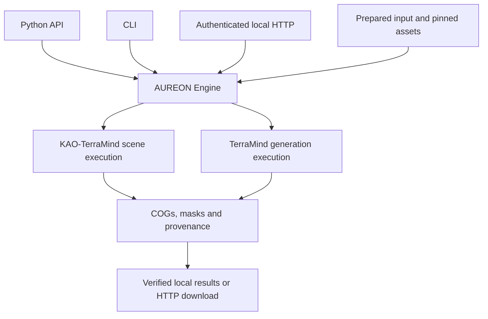

# How AUREON fits together

[Documentation](README.md) · [First result](../packaging/START-HERE.md) · [Python API](../packaging/PUBLIC-API.md)

AUREON connects geospatial input preparation, explicit model execution and
verified result delivery. Python, CLI and the local HTTP service use the same
Engine. Model assets and user imagery are supplied separately from the package.

## Choose an interface

| Interface | Use it for | Entry point |
| --- | --- | --- |
| Python | Scripts, pipelines and repeated serial jobs | `aureon.api`, `run_model`, `open_model_session` |
| CLI | Preparing inputs, checking profiles and running explicit jobs | `aureon-prepare`, `aureon-engine` |
| Local HTTP | Authenticated upload, submission, status and artifact download | `aureon-service`, `aureon-service-client` |

Scene and generation use separate locked dependency environments. Run one model
worker per local service; a resident session accepts one in-flight job at a time.
See [service setup](../packaging/ASYNC-SERVICE.md) and
[session semantics](../packaging/PUBLIC-API.md) before integrating retries or concurrency.

## Follow a result through the Engine

1. **Prepare the input.** Preserve band order, physical units, coordinate reference system, pixel grid and validity mask. The [input contract](../packaging/INPUTS.md) defines accepted inputs.
2. **Select the model and profile.** Bind pinned assets to the task and dependency environment. Use the full-reference B route for a first installation; guarded profiles require their matching qualification.
3. **Execute explicitly.** A request identifies its input, model configuration and fresh output directory. Python execution requires `execute_model=True`.
4. **Retain the outputs.** Keep the COG, masks, provenance and receipt together. A valid file path alone is not evidence that a job succeeded.
5. **Close owned resources.** The one-shot facade owns shutdown; resident APIs expose session lifetime and cleanup. Inspect failures and cleanup receipts rather than treating an error as an empty prediction.

For HTTP clients, keep the same idempotency key and payload when retrying an
uncertain submission. Downloading a completed result is distinct from running a
new model job. The [serving guide](../packaging/ASYNC-SERVICE.md) documents the contract.

## Execution optimizations

The Engine includes resident execution, exact eligible encoder reuse and guarded
CUDA Graph paths. Eligibility depends on the model, input and execution profile.
TerraMind exposes `reuse="auto"` and `denoiser="graph"`; native denoising and
reuse-off remain available. These mechanisms do not qualify every input or device.

The [support matrix](MODEL-SUPPORT.md) records what was actually exercised by the
released wheel. FP32 parity checks execution fidelity; it does not establish
scientific accuracy or make generated S1GRD an observed measurement.

## Package and source identity

Use the official [release assets and checksums](releases/v0.1.0.md) for the
qualified installation. All 139 `aureon/` runtime/resource files in this source
tree match the official wheel byte for byte. Public documentation can evolve
after release without changing the wheel, dependency locks or release tag.
A source rebuild has its own artifact identity.

See [Contributing](../CONTRIBUTING.md) for the source map and the distinction
between CPU contract checks and model execution evidence.
