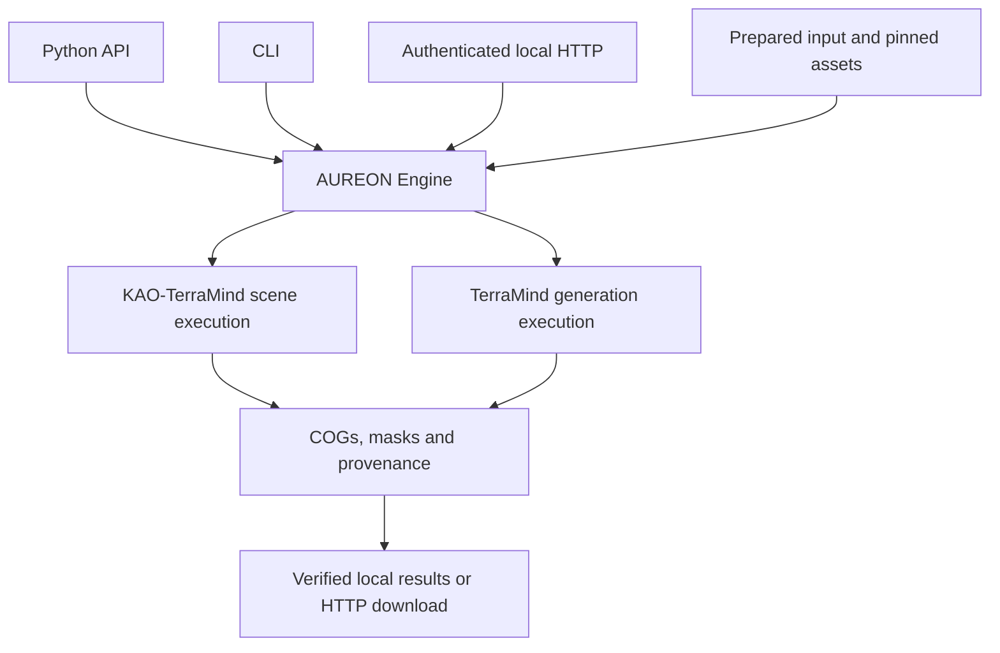

# How AUREON fits together

[Documentation](README.md) · [First result](../packaging/START-HERE.md) · [Python API](../packaging/PUBLIC-API.md)

AUREON specializes in inference for Generative Foundation Models for Earth
Observation while also supporting dense-prediction Earth models. It connects
geospatial input preparation, explicit model execution and
verified result delivery. Python, CLI and the local HTTP service use the same
Engine. Model assets and user imagery are supplied separately from the package.

## Runtime foundation

The documented scene and generation workflows execute TerraTorch models through
PyTorch. AUREON owns the surrounding input contracts, session lifecycle, qualified
execution optimizations and result delivery. The generation profile also installs
the diffusion and transformer dependencies used by TerraMind.

Use the locked `scene` or `generation` profile in the
[quickstart](../packaging/START-HERE.md). For source provenance and third-party
credits, see the [attribution record](../packaging/review/THIRD-PARTY-NOTICES.md).

## Choose an interface

| Interface | Use it for | Entry point |
| --- | --- | --- |
| Python | Scripts, pipelines and repeated serial jobs | `aureon.api`, `run_model`, `open_model_session` |
| CLI | Preparing inputs, checking profiles and running explicit jobs | `aureon-prepare`, `aureon-engine` |
| Local HTTP | Authenticated upload, submission, status and artifact download | `aureon-service`, `aureon-service-client` |

Scene and generation have explicit dependency profiles. An individual resident
session accepts one in-flight job at a time; current source can coordinate multiple
independent lanes and replicas through the Engine's scheduling interfaces.
See [service setup](../packaging/ASYNC-SERVICE.md) and
[session semantics](../packaging/PUBLIC-API.md) before integrating retries or concurrency.

## Follow a result through the Engine

1. **Prepare the input.** Preserve band order, physical units, coordinate reference system, pixel grid and validity mask. The [input contract](../packaging/INPUTS.md) defines accepted inputs.
2. **Select the model and profile.** Bind pinned assets to the task and dependency environment. Use the full-reference B route for a first installation; guarded profiles require their matching qualification.
3. **Execute explicitly.** A request identifies its input, model configuration and fresh output directory. Python execution requires `execute_model=True`.
4. **Retain the outputs.** Keep the COG, masks, provenance and receipt together. A valid file path alone is not evidence that a job succeeded.
5. **Close owned resources.** The one-shot facade owns shutdown; resident APIs expose session lifetime and cleanup. Inspect failures and cleanup receipts rather than treating an error as an empty prediction.

For HTTP clients, keep the same idempotency key and payload when retrying an
uncertain submission. Downloading a completed result is distinct from running a
new model job. The [serving guide](../packaging/ASYNC-SERVICE.md) documents the contract.

## Execution optimizations

The Engine includes resident execution, exact eligible encoder reuse and guarded
CUDA Graph paths. Eligibility depends on the model, input and execution profile.
TerraMind exposes `reuse="auto"` and `denoiser="graph"`; native denoising and
reuse-off remain available. These mechanisms do not qualify every input or device.

The [support matrix](MODEL-SUPPORT.md) records what was actually exercised by the
released wheel. FP32 parity checks execution fidelity; it does not establish
scientific accuracy or make generated S1GRD an observed measurement.

## Package and source identity

Use the official [release assets and checksums](releases/v0.1.0.md) for the
qualified installation. The published archives and release tag retain their original runtime and
dependency locks. Current source removes optional comparison workers and
diagnostics and integrates resident generation, queue, bridge and spatial APIs;
it therefore differs from the released wheel. A source rebuild
has its own artifact identity and requires separate validation.

See [Contributing](../CONTRIBUTING.md) for the source map and the distinction
between CPU contract checks and model execution evidence.

The [selected source lock](../packaging/review/SELECTED-ENGINE.json) binds all 225
current runtime payloads and generation dependency/build inputs to integrated
Best wheel `e09e710c…`. CI runs `python -I -B tools/check_selected_engine.py`
before contract tests. It stops on source/inventory/dependency drift without
loading a model. `--wheel /path/to/the/existing.whl` additionally checks the exact
archive and installed payload hashes. The original published release manifest
remains separate; historical competitor numbers belong to `0fa5ef2b…`.
An intentional future runtime change must update qualification and this lock
through review; CI never regenerates it automatically.

## Dependency and ownership boundaries

SDK/CLI/HTTP adapters use Engine requests and sessions. Execution adapters own
model, RNG, graph and buffer lifetimes; raster/source and delivery adapters own
their I/O resources. Validated value objects and deterministic policy functions
describe decisions, while explicit lifecycle owners perform stateful execution.

Private hosted products may consume this library, but the library must not import
provider deployment, commercial onboarding or payment code. Portable local
authentication, tenant isolation, admission, recovery and usage accounting remain
part of reusable serving. The historical `aureon.cloud` namespace contains only
the declared portable modules; it is not a dependency on a hosted product.

Build allowlists, static import-closure checks and public CI enforce this boundary.
Tests belong in the source distribution and repository, not the runtime wheel.
See [library scope](../packaging/LIBRARY-SCOPE.md) for exact packaging rules.

## Source ownership

| Package | Owns | Dependency boundary |
| --- | --- | --- |
| `aureon.api` | Stable user imports, requests and orchestration of sessions/scenes | Composes lower-level capabilities; preserves earlier module imports |
| `aureon.planning` | Placement decisions, memory estimates and bounded admission credits | Standard library only; no framework, service, network or model dependency |
| `aureon.integrations` | Owned/borrowed model bridges, TerraTorch task/config/checkpoint bridges and explicit preprocessing | Uses model-side FP32/RNG guards; does not import API orchestration or serving |
| `aureon.terramind_native`, `aureon.copgen_native` | Model construction, generation, graph/reuse, RNG and buffer lifetime | Explicit model execution; numerical changes require separate qualification |
| `aureon.sources`, `aureon.prepare`, `aureon.scene_pipeline` | Raster access, preparation, reconstruction and delivery | Explicit units, masks, spatial grids and I/O ownership |
| `aureon.scaling`, `aureon.serving`, portable `aureon.cloud` modules | Replica coordination and reusable local service | Consume Engine capabilities; exclude private hosted/provider code |

The planning and integration implementations have one owner each. The eight
earlier `aureon.api` module paths are thin aliases to those owners, not duplicate
implementations. Old and new paths return the same module, class and exception
objects; patching the earlier module still affects its canonical implementation.
Earlier pickle class references resolve through the aliases. Introspection and
new pickle module names now identify the owning package.

Continue importing user-facing types through `aureon.api`; these implementation
packages do not create an additional stable API commitment. Stateful queues,
sessions and admission-credit owners remain explicit objects. Pure placement
and estimate calculations are separate from dispatch and allocation; a clean
structure does not require removing useful stateful abstractions.

Run `python -I -B packaging/check_architecture.py` to check package/stub inclusion,
the extracted dependency boundaries and compatibility shims. Public CI also
checks fresh-process import order, lightweight imports, patch targets and old
pickle resolution. The checker covers ordinary/relative and literal dynamic
imports; it is not a security boundary for arbitrary computed imports.

This source reorganization retains the relocated implementation bytes and the
model execution files. It does not replace a released wheel or transfer its GPU
acceptance/performance claim to a rebuilt artifact.
